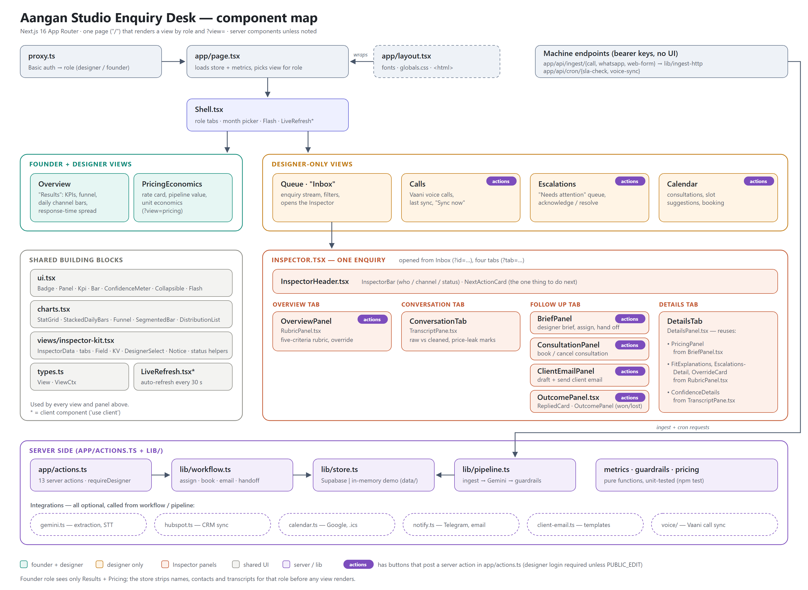

# Aangan Studio — Enquiry Desk

Intake automation + dashboard for Aangan Studio (Pune). Calls, WhatsApp threads and web forms come in; Gemini turns each
conversation into a structured brief; deterministic guardrails decide who is qualified, who needs a human, and what must
never be said about price; designers work the queue; Nikhil sees **only the results**.

**Stack:** Next.js 16 (App Router) · React 19 · Tailwind 3 · Supabase (Postgres) · Gemini API · Vercel.

## Two audiences, enforced in code

| Role | Sees | Never sees |
|---|---|---|
| **Designer / front desk** | Enquiry stream, transcript inspector (raw vs cleaned text, confidence), five-criteria rubric, designer brief, escalation queue + overrides, calendar, client emails, per-enquiry pricing | — |
| **Founder (Nikhil)** | Outcome numbers: volume, response-time distribution, qualification rates, handoff success, escalation & override rates, consultations, pipeline, unit economics | Transcripts, client names/phones/emails, summaries, locations, per-lead rows |

This is enforced in the data layer (`lib/store.ts` strips personal data for the founder role and the Supabase query only
selects outcome-level columns), not just by hiding tabs. **Nikhil needs no sign-in**: an anonymous visit to the site shows his results view — aggregate numbers only, no names, contact details, transcripts or locations (the founder login still works too). **Designers sign in** (Basic auth, link in the page header or `/?login=1`) for the full tool; every server action and every other path requires that login. **Public-view switch:** setting `PUBLIC_VIEW=true` (as on the current deployment) lets anyone READ the designer screens (enquiries, transcripts, escalations, calendar) with no login, while every button (a server action) still needs the designer login — a viewer sees a “View only” banner and a “Sign in to edit” button, and the results-only view stays one click away (`/?as=founder`). Ingest/cron endpoints keep their bearer keys. **Unset `PUBLIC_VIEW` before real client data flows**, which puts the designer screens back behind the login. **Public-edit switch:** `PUBLIC_EDIT=true` (as on the current deployment) removes the login entirely — anyone with the link can read AND use every button (qualify, reject, assign, book, mark won, send email when enabled); only the dashboard page is opened this way, and ingest/cron keep their bearer keys. **Unset `PUBLIC_EDIT` (and `PUBLIC_VIEW`) before real client data flows.** Access rules live in `proxy.ts` and are unit-tested. Note the public page does show business totals (volume, pipeline value, revenue) to anyone with the address; to lock it again, revert the "PUBLIC RESULTS" block in `proxy.ts`.

## Quick start (no accounts needed — demo mode)

```bash
npm install
cp .env.example .env.local     # optional for demo mode
npm run dev                    # http://localhost:3000
```

With no Supabase keys the app runs in **demo mode** on the 40 real September-2026 enquiries held in memory (every button
works; changes reset on restart). Preview each role locally with `/?as=designer` and `/?as=founder`.
`DEMO_SYNTHETIC=160 npm run dev` pads the month to ~200 with clearly-flagged simulated rows.

```bash
npm test                       # 70+ checks: the rules reproduce Nikhil's expected outcome for all 40 real enquiries
npm run typecheck
npm run gemini:check -- T10    # live Gemini call on one real enquiry, diffed against the expected result
NEXT_PUBLIC_SUPABASE_URL=… SUPABASE_SERVICE_ROLE_KEY=… npm run smoke   # drives the full designer workflow on a REAL Supabase with a throwaway enquiry, then deletes it
npm run ingest:demo            # 3 sample enquiries through the REAL pipeline: clear lead, garbled call (held by the gate), high-value fringe
```

## Set up Supabase

1. Create a project (choose **ap-south-1 Mumbai**, matching Vercel's `bom1`).
2. **Easiest — no CLI:** SQL editor → New query → paste the whole of [`supabase/setup-and-seed.sql`](supabase/setup-and-seed.sql)
   (schema + the 40 real enquiries, designers, tool costs) → Run. It is atomic: it aborts and changes nothing if `enquiries`
   already has data. Regenerate it any time with `npm run seed:sql` (add `-- --synthetic 160` for simulated rows).
   *Or* run just [`supabase/schema.sql`](supabase/schema.sql) (idempotent; RLS on, **no** public policies) and seed from the CLI (step 4).
3. Put `NEXT_PUBLIC_SUPABASE_URL` and `SUPABASE_SERVICE_ROLE_KEY` (Project Settings → API; server-only) in `.env.local` and in Vercel.
4. CLI seeding (alternative to the SQL paste):
   ```bash
   npm run seed                          # the 40 real enquiries + designer directory + tool costs
   npm run seed -- --synthetic 160       # optional: + 160 simulated (is_synthetic) → ~200 for the month
   npm run seed:reset -- --yes           # wipe the dashboard tables and re-seed (destructive)
   ```
   The designer directory is seeded with a **mock roster of 14** (`npm run designers:mock` reloads it): Aryan, who is named in the source, plus 13 fictional designers flagged `is_sample` with reserved `.example` emails and fake numbers. Leads are load-balanced across all of them (large or founder-connected leads go to senior designers / the principal), and the app refuses to put a sample designer in a LIVE client email. **Replace them with the real team before go-live** (Supabase → Table Editor → `designers`).

## The guardrails (all in `lib/guardrails.ts`, `lib/pricing.ts` — pure functions, unit-tested)

**A. Transcription & understanding** — *Confidence gate.* If composite confidence is under **85%**, or scope/location came
through *ambiguous* (garbled/contradictory — not merely unmentioned), the enquiry is **held**: an escalation goes to the front
desk (founder if it's a big-ticket lead) and **no brief reaches a designer**. Gemini doesn't expose a calibrated STT
confidence, so the model's self-assessment is combined with a penalty per `[inaudible]` marker and the ambiguity checks —
**calibrate `CONFIDENCE_THRESHOLD` on a labelled sample of real calls.** If Gemini is down, the raw text is still stored and
escalated (`ai_failure`); no enquiry is ever dropped. Designers receive a structured **brief card** (client, contact,
verified scope, style, timeline, AI summary, notes) instead of a blind forward.

**B. Lead qualification** — Nikhil's five-criteria rubric (`qualified.md`). Hard facts (a named city, a number of weeks, a
rupee figure) override the model. Unclear on 1–3 → **gray-area queue** with the *one* question to ask (never about budget).
Unclear on 4–5 → qualified, with a note. A clear fail → decline, **except** high-value fringe leads (e.g. outside the area but
₹15–20L) which go to review, and **10% of declines are audit-sampled** so the false-negative rate is measurable. Human
overrides feed the dashboard's false-positive / false-negative rates.

**C. Pricing & anchoring** — your pricing guide says *no number may ever be quoted to a client*, so the module is
**internal only**: indicative ranges feed pipeline value and the designer brief, never the client. Every client-facing string
passes a price linter; the only answer to a price question is the approved deflection. A *volunteered* budget clearly below
the scope's cost → pricing escalation; below the indicative band → anchoring-risk flag; luxury/structural/automation work →
senior review. The studio side of every conversation is also scanned: if the human or voice agent *states* a price, it raises
`agent_policy_breach` (repeating the caller's own figure is allowed).

**Service recovery** — existing-client complaints, missed calls, and responses slower than 24h raise escalations.

## Rules taken from your files — and what to confirm

Implemented from `services.md`, `qualified.md`, `pricing.md`. Assumptions I had to make are env-tunable in
[`lib/config.ts`](lib/config.ts):

* "Budget clearly below" = top of the volunteered range under **50%** of the cheapest plausible cost (₹3.5L single room; ₹1,800/sq ft residential; ₹1,200/sq ft commercial).
* Timeline: under **6 weeks** fails (services.md); 6–8 weeks is "unclear"; 8+ passes. `qualified.md` also says a single failed criterion → decline, while a later line says "two or more" — I follow the intro and the real transcripts (one failure → decline).
* High-value fringe = budget ≥ ₹15L or ≥ 2,000 sq ft; audit sample 10%; minimum commercial 500 sq ft (what the front desk told caller T18).
* Your brief says average projects are ₹8–14L; `pricing.md` (₹1,800+/sq ft) implies larger. Pipeline values use `pricing.md` and the dashboard reports the *measured* average.
* Front-desk hours 10am–7pm **Mon–Sat** (Saturday assumed).

## Deploy to Vercel

1. Push this folder to a Git repo and import it in Vercel (framework: Next.js; `vercel.json` sets region `bom1`, security headers, no-store caching, and a daily SLA sweep).
2. Add the environment variables from [`.env.example`](.env.example). **Required in production:** `NEXT_PUBLIC_SUPABASE_URL`, `SUPABASE_SERVICE_ROLE_KEY`, `GEMINI_API_KEY`, `DESIGNER_PASSWORD`, `FOUNDER_PASSWORD`, `INGEST_API_KEY`, `CRON_SECRET`. The app **refuses to serve** in production without both dashboard passwords — unless `PUBLIC_EDIT=true` is set, which runs a password-free demo (no login anywhere on the dashboard; demo or sample data only).
3. Deploy. Cron: Hobby plans allow daily jobs; on Pro change `vercel.json` to e.g. `*/30 * * * *` for tighter SLA sweeps.

## Intake API

All machine endpoints take `Authorization: Bearer $INGEST_API_KEY`.

```bash
# A call, as a transcript (or multipart with an `audio` file ≤ 4 MB for Gemini speech-to-text)
curl -X POST $URL/api/ingest/call -H "Authorization: Bearer $INGEST_API_KEY" -H "content-type: application/json" \
  -d '{"source_ref":"call-123","from":"+919800000000","received_at":"2026-10-07T11:02:00+05:30","duration_sec":240,
       "text":"Front Desk: Good morning...\nCaller: Hi, I have a 3BHK in Baner..."}'

# WhatsApp thread / web form (structural placeholders — point your provider's adapter here)
curl -X POST $URL/api/ingest/whatsapp -H "Authorization: Bearer $INGEST_API_KEY" -H "content-type: application/json" \
  -d '{"name":"Kiran","thread":[{"from":"customer","text":"Hi, 4BHK in Viman Nagar, full interiors"}]}'
curl -X POST $URL/api/ingest/web-form -H "Authorization: Bearer $INGEST_API_KEY" -H "content-type: application/json" \
  -d '{"name":"Amol Patil","email":"amol@example.com","fields":{"Location":"Kondhwa","Carpet area":"1,150 sq ft"}}'
```

`source_ref` de-duplicates retries. Add `"async": true` to get a `202` immediately and process in the background.

## Voice calls — Vaani Voice (pull, no webhooks)

Integrated against the documented Vaani Voice REST API (`https://docs.vaanivoice.ai`: base `https://api.vaanivoice.ai`, header
`X-API-Key: vaani_…`). We **poll** `GET /api/call-history` (inbound calls only), fetch `GET /api/transcript/{call_id}` for each
new one, and run it through the normal pipeline (Gemini → guardrails → designer brief → HubSpot). Details that matter:
timestamps are UTC, `duration_ms` is not milliseconds (we compute duration from the timestamps), transcript turns are
labelled `AGENT:`/`USER:` (mapped to `Front Desk:`/`Caller:`), and a call is only ingested once Vaani's
`post_processing_status` is `completed`. Enquiries are de-duplicated on `vaani:<call_id>`, so re-runs never double-count; a completed
call with no transcript is recorded as a dropped call that needs a callback, never lost.

* **Set `VAANI_API_KEY`** (Vercel → Environment Variables). Optional: `VAANI_BASE_URL`, `VAANI_INCLUDE_OUTBOUND=true`.
* **Check it:** `VAANI_API_KEY=vaani_… npm run voice:check` (read-only; `-- --hours 72`, `-- --ingest` to create enquiries).
* **When it runs:** a daily cron (`/api/cron/voice-sync`), plus a small background pull (at most every 2 minutes per server
  instance) whenever a designer has the dashboard open. Vercel Hobby only allows daily cron; for near-real-time on a quiet
  dashboard, point any scheduler (cron-job.org, GitHub Actions, a Pro-plan cron) at
  `GET /api/cron/voice-sync` with `Authorization: Bearer $CRON_SECRET` every few minutes.
* **The Vaani account must be set up first** (create an agent, set up telephony, generate the key): until the account has a client/agent,
  Vaani's call-history returns `Invalid client_id format`, which the sync reports as an error and retries later.
* Voice-agent configuration guidance: [`docs/voice-agent-brief.md`](docs/voice-agent-brief.md).

## Integrations

* **Email to the enquirer** — three templates (`confirmation`: designer name/phone/email, the promised callback time or the
  booked consultation + `.ics` attachment, what happens next, what to have ready; `clarification`: the one question;
  `decline`: the approved script). Template-built, price-linted, **drafted for a designer to review and send**. Defaults to
  **dry-run**; set `CLIENT_EMAIL_MODE=live` + `RESEND_API_KEY` + `MAIL_FROM` to send. `AUTO_SEND_CLIENT_EMAIL=true` sends the
  confirmation automatically on qualification. Every email is logged in `outbound_emails`; a real send counts as the first response.
* **Alerts** — Telegram bot and/or email for escalations and designer briefs (no transcripts; the founder's alerts carry no personal details).
* **HubSpot** — set `HUBSPOT_ACCESS_TOKEN` to a HubSpot **service key** (Development → Keys → Service Keys; HubSpot has retired legacy private apps) with scopes `crm.objects.contacts.read/write` and `crm.objects.deals.read/write`. Verify with `HUBSPOT_ACCESS_TOKEN=pat-… npm run hubspot:check`. Backfill existing enquiries with `npm run hubspot:backfill` (`-- --dry-run` to preview, `-- --undo` to remove what it created; idempotent). Qualified/in-review leads get a Contact, a Deal whose stage tracks the pipeline (new → qualified → consultation → won/lost) and a summary Note. No transcripts; declined leads and non-leads are never synced. Override stage IDs with `HUBSPOT_STAGE_*` if your pipeline isn't the default.
* **Calendar** — consultations live in the dashboard (double-booking blocked, slot suggestions). Optional Google Calendar sync — preferred: a **service account** (`GOOGLE_SERVICE_ACCOUNT_JSON` + `GOOGLE_CALENDAR_ID` of a calendar shared with it; never expires; verify with `npm run calendar:check`); alternatively OAuth (`GOOGLE_CLIENT_ID/SECRET/REFRESH_TOKEN`, which expires after 7 days while the app is in Testing mode). Clients receive the `.ics` in the confirmation email; with OAuth they are only invited by Google if `GOOGLE_INVITE_CLIENT=true`.

## Security notes

Basic auth in `proxy.ts` (constant-time compare, role header stripped from inbound requests); RLS on every table with no
policies; service-role key server-only; bearer-protected machine endpoints that fail closed; transcripts treated as
untrusted (the extraction prompt ignores instructions inside them, output is schema-validated and clamped); outbound email is
template-built and escaped; recording downloads are https + host-allowlisted. Gemini and Supabase see client conversations —
make sure that is covered by your privacy notice.

## Honest data notes

* The 40 seed enquiries are real and anonymised. They contain **no won/lost outcomes, designer assignments or resolved escalations**, and **web-form response times weren't recorded** — the dashboard shows these as empty rather than inventing them. Use `--synthetic` to see every chart populated (rows are flagged and can be hidden).
* Vaani masks phone numbers, so a masked caller ID can't be used for call-backs — the voice agent should capture a number in the conversation.
* Vercel serverless request bodies are capped at ~4.5 MB; send transcripts, or short recordings.

## Project map



Full-resolution vector version: [`docs/component-map.svg`](docs/component-map.svg).


```
app/            page.tsx (role-aware views) · actions.ts (server actions) · api/ingest|cron
components/     Shell, ui primitives, views/ (Overview, Queue+inspector, Escalations, Calendar, PricingEconomics)
lib/            guardrails · pricing · gemini · pipeline · workflow · metrics · store (Supabase|demo) · hubspot · calendar · client-email · notify · voice/
data/           sept-2026-enquiries (the 40 real records + expected outcomes) · synthetic · build-dataset
supabase/       schema.sql          scripts/  seed · test-guardrails · gemini-check
proxy.ts        auth + roles        vercel.json  env, cron, headers
```
